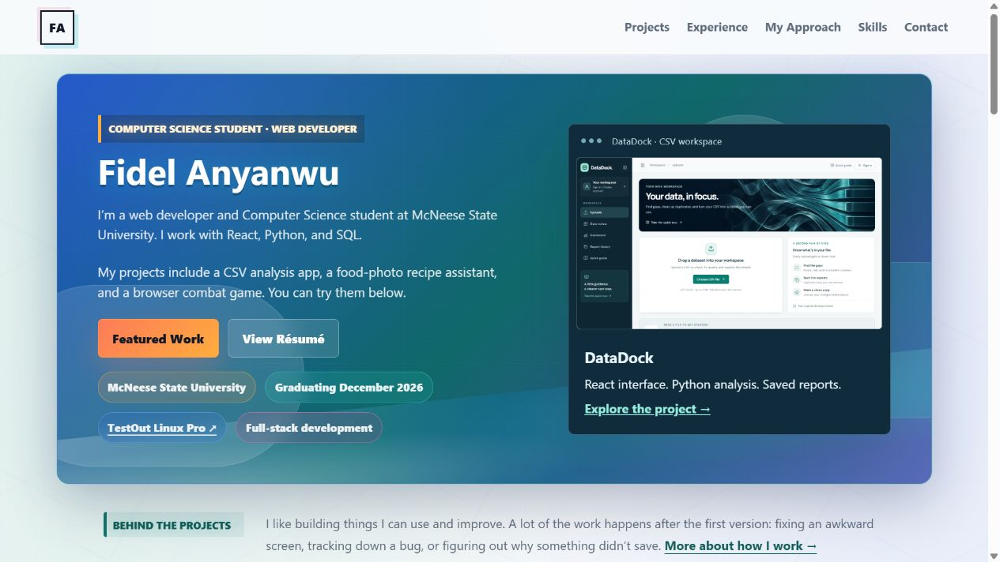

# Fidel Anyanwu Portfolio

A responsive personal portfolio built with HTML and CSS. It brings together my web applications, programming projects, and experience in teaching, robotics research, and student support.

## Links

- [Live portfolio](https://fidel-portfolio-eta.vercel.app/)
- [View résumé](https://fidel-portfolio-eta.vercel.app/assets/fidel-anyanwu-resume.pdf)
- [Repository](https://github.com/Fidel2197/Portfolio)



## Overview

My portfolio includes web applications, browser games, and a team bookstore project. DataDock, SnapChef, and SignalDesk are featured on the homepage.

Project pages include screenshots, workflow steps, implementation details, source code, and links to the next project. Experience covers my university roles, coursework, and Linux certification.

## Features

- Featured projects with screenshots, stack summaries, and direct application links
- Individual project pages with workflow steps and next-project navigation
- Experience and education with expandable work examples and certification links
- Skills linked to the projects where I used them
- A development approach page covering planning, testing, and iteration
- Contact details, professional links, and a downloadable résumé
- Responsive layouts for desktop, tablet, and mobile screens

## Technologies Used

- HTML5 for page structure and navigation
- CSS3 for responsive layouts, typography, and visual styling
- Local image and SVG assets for project previews and graphics
- Vercel for static hosting

## Project Structure

```text
Portfolio/
  index.html           # Homepage and project gallery
  experience.html      # Work experience and education
  skills.html          # Technical skills and project examples
  approach.html        # Development process
  contact.html         # Contact links and résumé
  datadock.html        # Project pages, with one page per project
  styles.css           # Shared styles
  assets/              # Project images, graphics, and résumé PDF
```

## Getting Started

```bash
git clone https://github.com/Fidel2197/Portfolio.git
cd Portfolio
```

Open `index.html` in a browser. No package installation or build step is required. Any static HTTP server can also serve the project directory.

## Author

Built by Fidel Anyanwu, a Computer Science student at McNeese State University.
